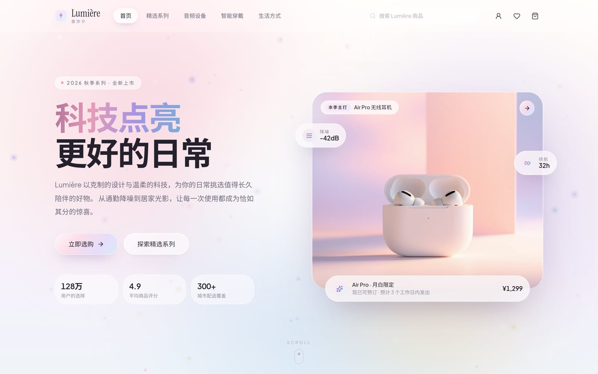
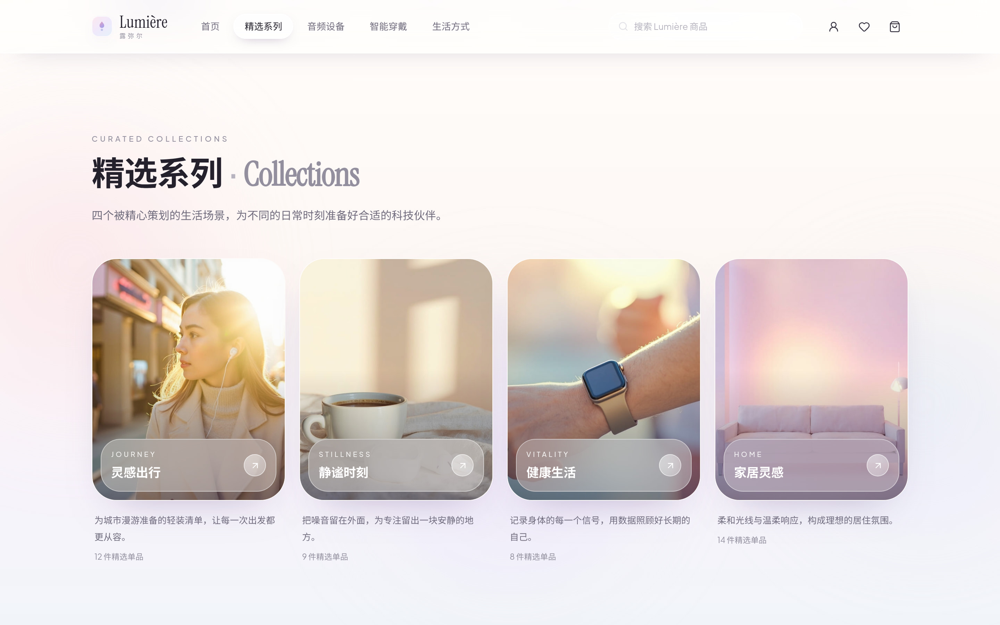
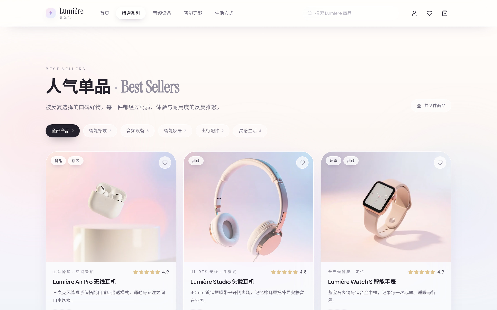
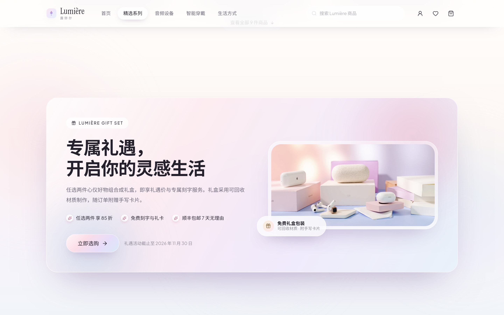
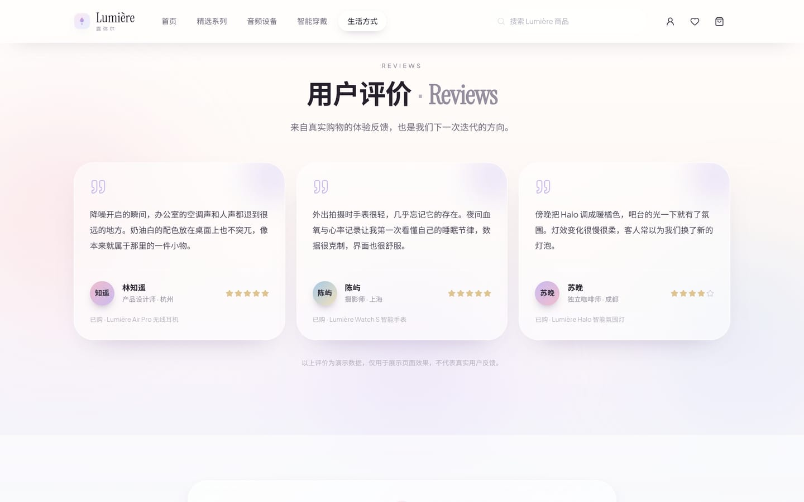
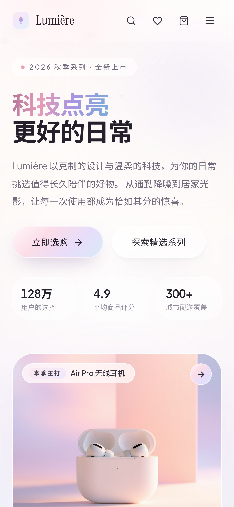
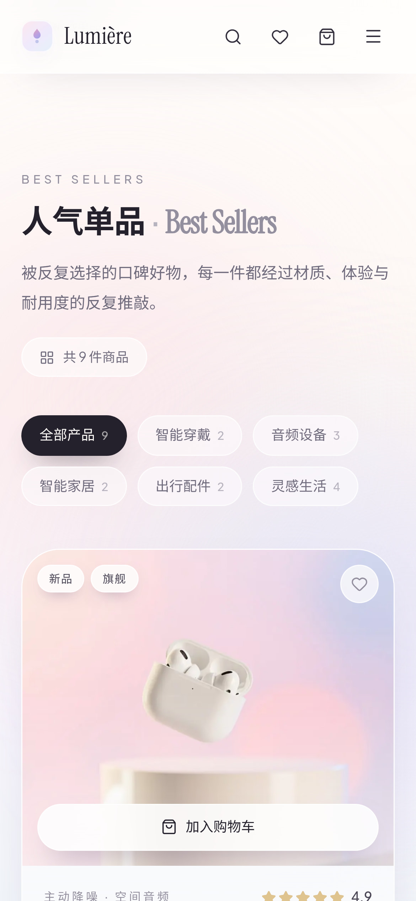
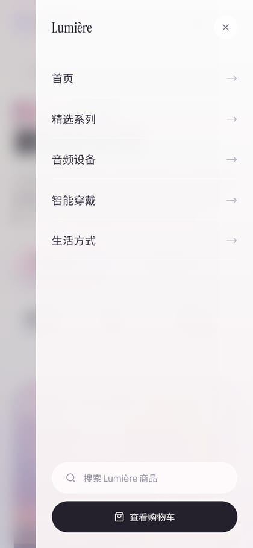

<div align="center">

# Lumière 露弥尔

### 科技点亮更好的日常 · *Light up a better everyday*

**奶油马卡龙 × Apple 极简 × Glassmorphism × 轻粒子** 的科技生活方式电商首页

[](https://nextjs.org)
[](https://react.dev)
[](https://www.typescriptlang.org)
[](https://tailwindcss.com)
[](https://motion.dev)
[](#-license)

[在线预览](#-预览) · [快速开始](#-快速开始) · [功能清单](#-功能清单) · [设计系统](#-设计系统) · [文档](#-文档)

</div>

---

## 📸 预览

> 以下截图均为**原生高分辨率**：桌面端 2880 × 1800（2× 视网膜），移动端 1170 × 2532（3× 视网膜），JPEG q92 + 4:4:4 无色度采样，合计约 2.5MB。点击图片可查看原始尺寸。

<div align="center">
  
</div>

<div align="center">
  
  
</div>

<div align="center">
  
  
</div>

<div align="center">
  
  
  
</div>

---

## 📖 项目描述

**Lumière 露弥尔** 是一个面向「科技生活方式」的高保真电商首页演示项目。

品牌主张是 **「科技点亮更好的日常」**——用克制的设计与温柔的科技，为用户的日常挑选值得长久陪伴的好物。商品覆盖无线耳机、智能手表、智能家居、数码配件与出行用品。

网站语言为简体中文，货币单位为人民币（¥），整体视觉在 Apple 式极简留白的基础上，形成奶油白 / 浅粉 / 淡紫 / 雾霾蓝 / 香槟金的马卡龙识别度：以大面积柔和渐变、半透明磨砂玻璃卡片、细腻边缘高光和轻粒子特效，构成轻盈、通透、克制的品牌体验。

> ⚠️ 本项目为**前端演示站点**：所有商品、价格、评价与统计数据均为模拟数据，不含真实后端、数据库与支付系统；涉及真实业务的部分（账户、结算、文章详情）会以提示条明确说明。

### English Summary

**Lumière** is a high-fidelity e-commerce landing page for a tech-lifestyle brand. It blends Apple-style minimalism with a cream-macaron palette, layered glassmorphism, and restrained particle effects.

The site is a **front-end demonstration**: every product, price, and review is mock data, with no back end, database, or payment integration.

---

## ✨ 功能清单

所有交互均为真实可用状态，无「假按钮」。

| 模块 | 能力 | 说明 |
| --- | --- | --- |
| **顶部导航** | 固定磨砂玻璃、滚动增强模糊 | 滚动后自动加深背景模糊与底部描边；`IntersectionObserver` 跟踪当前板块并高亮 |
| | 实时搜索 | 输入即匹配商品名称 / 副标题 / 描述 / 标签，实时显示命中数量，并给出下拉建议 |
| | 收藏夹抽屉 | 心形收藏、角标计数、抽屉内一键全部加购 |
| | 购物车抽屉 | 数量增减、移除、小计、免运费进度条、金额实时汇总 |
| | 移动端侧滑菜单 | 独立导航、搜索入口与购物车入口 |
| **Hero 首屏** | 动态极光渐变 | 4 层柔光光晕以不同速率漂移 |
| | Canvas 微粒场 | 移动端自动降至 45% 密度，页面不可见时自动暂停 |
| | 滚动视差 | 主视觉与文案以不同速率位移 |
| **商品分类** | 6 张玻璃卡片 | 全部产品 / 智能穿戴 / 音频设备 / 智能家居 / 出行配件 / 灵感生活 |
| | 分类联动 | 点击卡片或顶部导航即筛选下方商品并平滑滚动定位 |
| **精选系列** | 4 张场景卡 | 灵感出行 / 静谧时刻 / 健康生活 / 家居灵感 |
| **人气单品** | 6 张商品卡 | 默认展示 6 件，可展开全部 9 件；含图片、描述、价格、评分、标签、色卡 |
| | 悬停动效 | 卡片轻微上浮、图片缓动缩放、玻璃高光跟随鼠标 |
| | 一键加购 | 图片浮层快捷加购（移动端常驻）＋ 信息区独立按钮 |
| **促销 Banner** | 礼遇专题 | 权益清单 + 活动说明 + 跳转购买 |
| **灵感生活** | 3 张图文卡 | 城市漫游 / 高效日常 / 自在身心 |
| **用户评价** | 3 条评价 | 头像、昵称、角色、评分、已购商品，并**明确标注为演示数据** |
| **页脚** | 邮件订阅 | 邮箱格式校验 + 订阅成功态切换 |
| | 三栏导航 / 社交 | 全部链接均有明确反馈 |

---

## 🎨 设计系统

完整规范见 **[`docs/DESIGN-SYSTEM.md`](docs/DESIGN-SYSTEM.md)**。

### 色彩

| 名称 | 主色 | 用途 |
| --- | --- | --- |
| 奶油白 `cream` | `#FFFCFA` → `#F6EEE5` | 页面底色、卡片底、容器 |
| 浅粉 `blush` | `#FCE8EF` / `#E8A2BA` | 主视觉光晕、标签、强调色 |
| 淡紫 `lilac` | `#F0EAFC` / `#B3A0E6` | 玻璃高光、次级强调 |
| 雾霾蓝 `mist` | `#E6F1F9` / `#83AAD2` | 冷调平衡、科技感表达 |
| 香槟金 `champagne` | `#F9F0DC` / `#E0C48F` | 评分、价格、质感细节 |
| 墨色 `ink` | `#24212C` → `#B7B3BF` | 六级文字层级 |

### 字体

- **拉丁字符**：Plus Jakarta Sans（400/500/600/700/800），几何感几何体，适合精致商业界面
- **英文点缀**：Instrument Serif，用于 `Best Sellers` `Collections` `Journal` `Reviews` 等副标题
- **中文**：系统 CJK 栈（PingFang SC / HarmonyOS Sans SC / Noto Sans CJK SC / 微软雅黑），字重 `font-semibold`，字距 `-0.02em`

所有字体均**本地自托管**（`src/assets/fonts/`，共 15 个 woff2 子集，约 368KB），构建过程不请求任何外部 CDN。

### 玻璃拟态

```css
.glass        /* 常规卡片：22px 模糊 + 170% 饱和度 + 白色半透明渐变 */
.glass-strong /* 浮层/抽屉：30px 模糊 + 180% 饱和度 */
.glass-soft   /* 内嵌区域：14px 模糊 */
.glass-card   /* 配合 --mx / --my 变量实现鼠标跟随径向高光 */
```

### 动效曲线

统一使用 `cubic-bezier(0.22, 1, 0.36, 1)`（silk），滚动淡入 0.8s，悬停上浮 0.55s，抽屉进出 0.55s，Toast 0.45s。

---

## 🚀 快速开始

```bash
# 1. 安装依赖
npm install

# 2. 本地开发（默认 http://localhost:3000）
npm run dev

# 3. 生产构建
npm run build

# 4. 启动生产服务
npm start
```

### 可用命令

| 命令 | 作用 |
| --- | --- |
| `npm run dev` | 开发服务器（HMR） |
| `npm run build` | 生产构建，含 TypeScript 类型检查 |
| `npm start` | 启动生产服务器 |
| `npm run lint` | ESLint 检查 |
| `npm run images:generate` | 重新生成全部商品 / 场景图（需 `mmx` CLI 已登录） |
| `npm run images:optimize` | 压缩优化图片（2.53MB → 0.68MB） |
| `npm run fonts:fetch` | 重新抓取本地字体子集 |
| `npm run sync:gitee` | 创建并推送到 Gitee 镜像仓库（需 `GITEE_TOKEN`） |

**环境要求**：Node.js ≥ 20（开发使用 Node 24）。依赖版本已在 `package-lock.json` 中锁定。

---

## 🧰 技术栈

| 能力 | 选型 | 说明 |
| --- | --- | --- |
| 框架 | **Next.js 16**（App Router） | 整站静态预渲染，产物为纯静态页面 |
| UI 运行时 | **React 19** | 并发特性 + `use()` |
| 类型 | **TypeScript 5**（strict） | 全量类型安全，构建内含类型检查 |
| 样式 | **Tailwind CSS v4** | CSS-first `@theme` 设计令牌，无 `tailwind.config.ts` |
| 动画 | **Motion for React** v14 | 滚动淡入、视差、布局动画、抽屉与弹层过渡 |
| 图标 | **lucide-react** | 全站统一线性图标风格 |
| 字体 | **next/font/local** | 自托管 woff2，零外部请求 |
| 状态 | **React Context + useReducer** | 购物车 / 收藏 / 分类 / 搜索，轻量无额外依赖 |

---

## 📁 项目结构

```
lumiere-store/
├── docs/
│   ├── DESIGN-SYSTEM.md      # 设计系统完整规范
│   ├── DEVELOPMENT.md        # 开发指南与扩展方式
│   ├── DEPLOYMENT.md         # 部署指南（含离线部署）
│   ├── ASSETS.md             # 图片 / 字体资产说明
│   └── images/               # 文档配图
├── public/images/             # 商品 / 场景 / 促销图（18 张）
├── scripts/                   # 图片生成与压缩、字体抓取脚本
├── src/
│   ├── app/
│   │   ├── layout.tsx        # 根布局：本地字体、metadata、StoreProvider
│   │   ├── page.tsx          # 首页组合 + 全局渐变背景
│   │   ├── globals.css       # 设计系统：@theme 令牌、玻璃工具类、关键帧
│   │   └── icon.svg          # 品牌图标（favicon）
│   ├── assets/fonts/          # 自托管 woff2 字体子集
│   ├── components/
│   │   ├── providers/        # StoreProvider：全局状态
│   │   ├── layout/           # Navbar / Footer / CartDrawer / WishlistDrawer
│   │   │                     # SearchPanel / Toaster / BrandMark
│   │   ├── sections/         # 9 个首页区块组件
│   │   ├── commerce/         # ProductCard
│   │   ├── effects/          # Particles / AuroraBackdrop / Reveal / Spotlight
│   │   └── ui/               # Button / GlassCard / Drawer / SectionHeading / StarRating
│   ├── lib/                  # data.ts（全部模拟数据）/ motion.ts / utils.ts
│   └── types/                # 领域类型定义
├── CHANGELOG.md
├── CONTRIBUTING.md
└── LICENSE
```

---

## ♿ 无障碍与性能

- **语义化**：导航 / 主体 / 页脚分区明确，图标按钮均带 `aria-label`，筛选与收藏按钮带 `aria-pressed`
- **键盘可达**：所有浮层支持 `Esc` 关闭；hover 浮出的操作按钮额外支持 `focus-within` 显现
- **焦点可见**：全局 `:focus-visible` 描边，不依赖浏览器默认样式
- **减少动态效果**：`prefers-reduced-motion: reduce` 时粒子只绘制一帧静态分布，CSS 过渡全部禁用，滚动动画降级为纯淡入（已实机验证无元素停留在不可见状态）
- **性能**：粒子使用单个 Canvas（限制 DPR ≤ 2），页面不可见时 `cancelAnimationFrame`；商品图走 `next/image` 按需优化；页面 100% 静态预渲染，无运行时数据请求

---

## 🚢 部署

见 **[`docs/DEPLOYMENT.md`](docs/DEPLOYMENT.md)**。

- 构建产物为纯静态页面，可直接托管在 Nginx / OSS / 内网静态服务器
- 依赖与字体全部内置，**目标服务器无需访问公网**
- 提供 Dockerfile 与 docker-compose 示例

---

## 📚 文档索引

| 文档 | 内容 |
| --- | --- |
| [`docs/DESIGN-SYSTEM.md`](docs/DESIGN-SYSTEM.md) | 色彩 / 字体 / 圆角 / 阴影 / 玻璃 / 动效 / 组件规范 |
| [`docs/DEVELOPMENT.md`](docs/DEVELOPMENT.md) | 环境、命令、组件开发规范、如何扩展商品与新板块 |
| [`docs/DEPLOYMENT.md`](docs/DEPLOYMENT.md) | 构建、静态托管、Docker、离线内网部署 |
| [`docs/ASSETS.md`](docs/ASSETS.md) | 图片生成方式与提示词、字体来源与许可 |
| [`CHANGELOG.md`](CHANGELOG.md) | 版本记录 |
| [`CONTRIBUTING.md`](CONTRIBUTING.md) | 参与贡献的约定 |

---

## 📄 License

[MIT](./LICENSE) © 2026 Lumière 露弥尔

> 商品图与场景图由 AI 生成，仅用于本演示项目；字体分别采用 SIL Open Font License 1.1。
